

  <a href="https://dann-studio.com">
    
  </a>

 

Construyo **software a la medida** para negocios que hoy operan con papel, WhatsApp y hojas de cálculo: plataformas web, aplicaciones móviles y automatización con IA. Desde **[Dann Studio](https://dann-studio.com)** acompaño cada proyecto de principio a fin: entiendo la operación, entrego una primera versión que se puede usar y lo dejo funcionando en producción. En mis ratos libres hago **Crazy Route**, un videojuego co-op en Godot.

 

  <a href="https://dann-studio.com">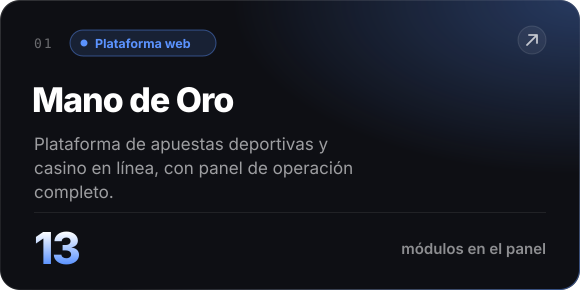</a>
  <a href="https://dann-studio.com">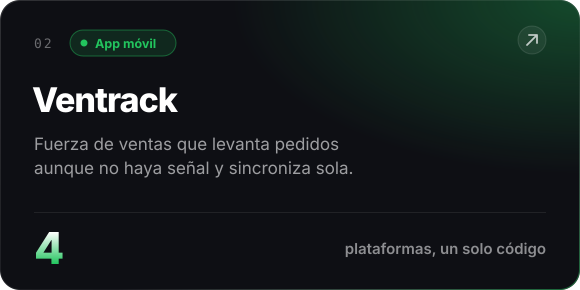</a>

  <a href="https://dann-studio.com">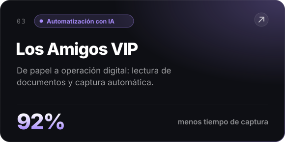</a>
  <a href="https://dann-studio.com">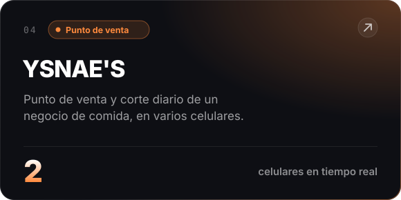</a>

  <a href="https://dann-studio.com">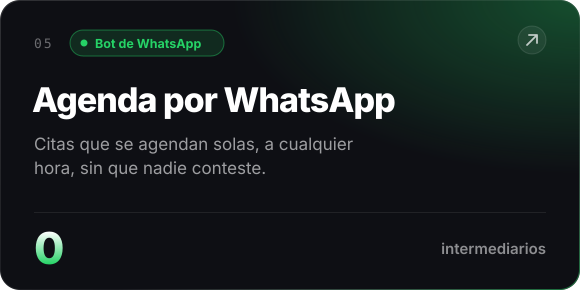</a>
  <a href="https://dann-studio.com">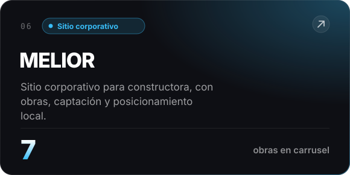</a>

  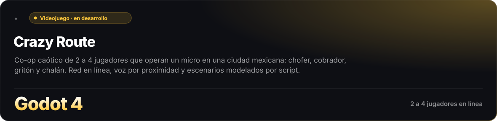

 

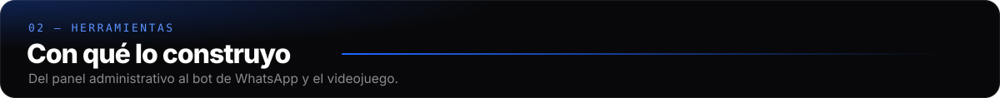

  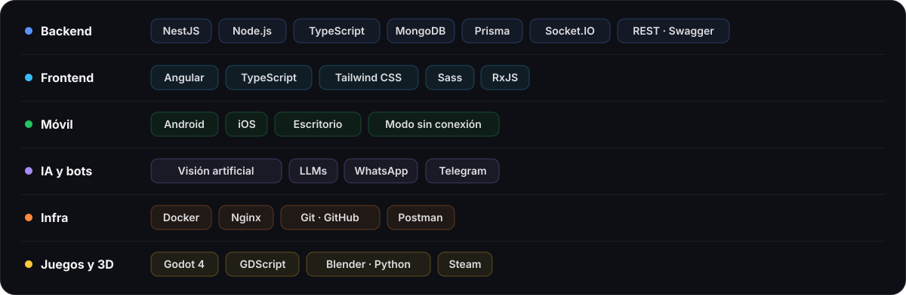

 

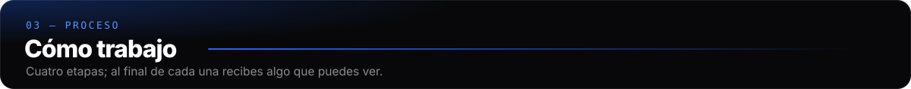

  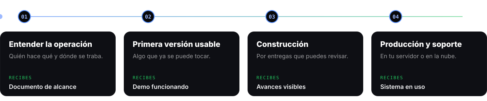

 

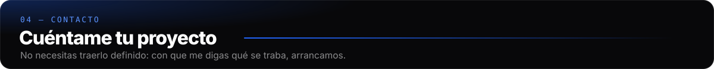

  
  &nbsp;
  
  &nbsp;
  

 

© 2026 Daniel Serrano · Dann Studio · Guadalajara, México

